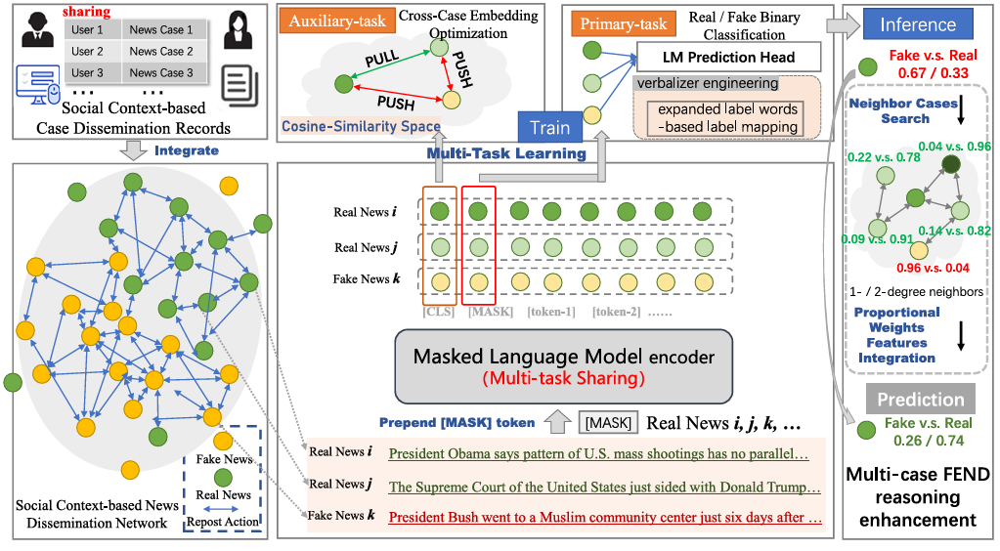
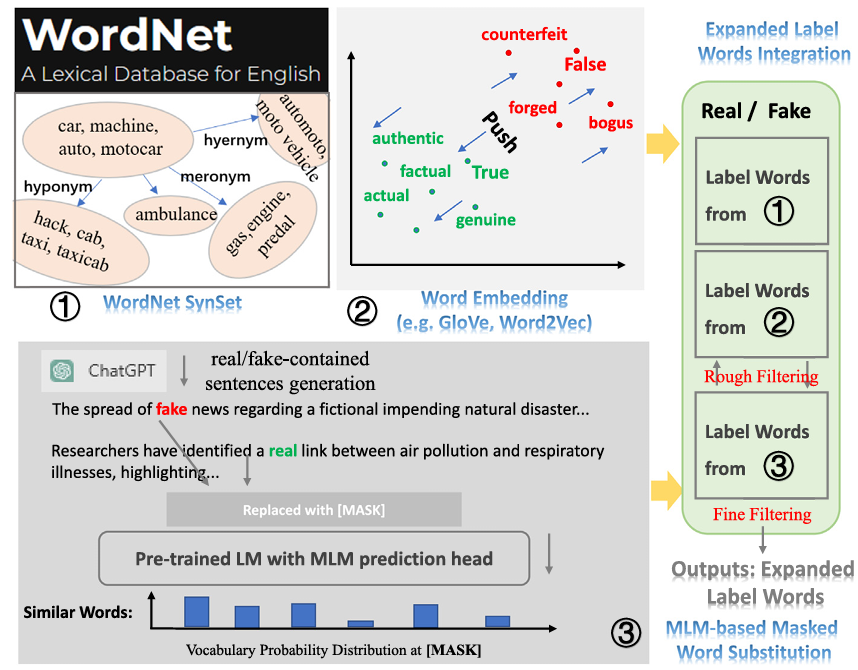

# PMTL-DisCo

PMTL-DisCo 论文复现代码（基于 Prompt-and-Align 处理逻辑扩展），用于 few-shot fake news detection。

## 目录结构

```text
configs/
  default.yaml                      # 默认实验配置
scripts/
  run_pmtl_disco.py                # 训练/评估入口
  build_graph.py                   # 从 raw social context 构图并缓存
  run_experiments.ps1              # politifact/gossipcop/fang 的批量实验
pmtl_disco/
  data/                            # few-shot 切分与图加载/构建
  modeling/                        # Prompt MLM + expanded verbalizer + multitask losses
  training/                        # 训练器（联合优化）
  inference/                       # 邻域推理增强
  pipeline.py                      # 端到端实验流程
data/
  ...                              # 已解压数据集
```

## 依赖安装

```bash
pip install -r requirements.txt
```

## 数据约定

复现使用当前仓库内 `data/`，无需重复解压。默认读取：

- `data/{dataset}_train_{n}.csv`
- `data/{dataset}_test.csv`
- `data/adjs/user_t5/{dataset}_nn_relations_{n}.pkl`

当预处理图不存在时，可从 raw 文件构图：

- `data/news_articles_raw/{dataset}_full_train{n}.csv`
- `data/social_context_raw/{dataset}_socialcontext_train{n}.csv`

## 先构图（可选）

```bash
python scripts/build_graph.py --datasets politifact gossipcop fang --few-shot 16 32 128 --threshold-user 5
```

## 单次运行

```bash
python scripts/run_pmtl_disco.py --dataset politifact --few-shot 16
```

常用覆盖参数：

```bash
python scripts/run_pmtl_disco.py \
  --dataset gossipcop \
  --few-shot 32 \
  --iters 20 \
  --epochs 3 \
  --batch-size 8 \
  --max-len 128 \
  --lr 5e-5 \
  --K 0.35 \
  --mu 0.65 \
  --alpha1 1 \
  --alpha2 0.01 \
  --gamma 0.1
```

## 批量运行（16/32/128）

```powershell
powershell -ExecutionPolicy Bypass -File scripts/run_experiments.ps1
```

## 默认超参（`configs/default.yaml`）

- few-shot: `{16, 32, 128}`（支持 64）
- epochs: `3`
- batch size: `8`
- max length: `128`
- lr: `5e-5`
- seed: `0`
- `K=0.35`, `mu=0.65`
- `alpha1=1.0`, `alpha2=0.01`
- `gamma=0.1`

## Visualizations

### PMTL-DisCo Architecture



*The model architecture of our proposed PMTL-DisCo, which is a prompting multi-task learning framework. Utilizing the constructed veracity dissemination consistency network (left) to train the “news distributed representation optimization” task; leveraging the Masked LM-based pseudo prompt-tuning to conduct the primary task, Real/Fake binary classification for FEND (center); and the adopted multiple neighboring news reasoning enhancement strategy during the FEND inference (right).*

### High-Quality Label Words Acquisition



*The illustration of our proposed novel approach for acquiring high-quality real/fake semantic-related label words.*

## Citation

If you find this work useful, please consider citing our paper:

```bibtex
@article{JIN2025110122,
title = {A prompting multi-task learning-based veracity dissemination consistency reasoning augmentation for few-shot fake news detection},
journal = {Engineering Applications of Artificial Intelligence},
volume = {144},
pages = {110122},
year = {2025},
issn = {0952-1976},
doi = {https://doi.org/10.1016/j.engappai.2025.110122},
url = {https://www.sciencedirect.com/science/article/pii/S0952197625001228},
author = {Weiqiang Jin and Ningwei Wang and Tao Tao and Mengying Jiang and Yebei Xing and Biao Zhao and Hao Wu and Haibin Duan and Guang Yang},
keywords = {Few-shot fake news detection, Prompt-based tuning, Multi-task learning, Masked language model, User spreading news engagement bias, Dissemination consistency reasoning augmentation},
}
```
